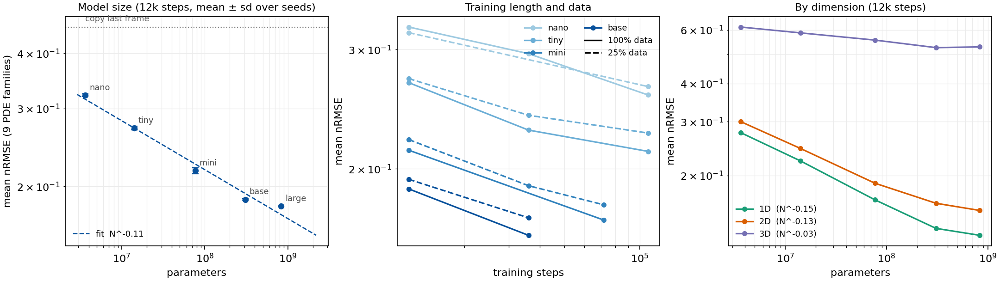

# OmniArch-pt (智算天璇)

A PyTorch re-implementation of **OmniArch**, a foundation model that forecasts 1D, 2D and 3D PDEs with one set of weights. Give it the first few frames of a simulation; it rolls the solution forward on its own.

> **Preview release (v0.2).** The checkpoints here are models retrained from scratch on a subsampled PDEBench. They are meant for deployment and demos, not as a reproduction of the paper's model or numbers.

The original code was MindSpore on Ascend; this repository is a fresh PyTorch rewrite with three checkpoints, `base`, `mini` and `tiny`. It follows the architecture of the ICML 2025 paper ([arXiv:2402.16014](https://arxiv.org/abs/2402.16014)) but is trained from scratch at a much smaller scale, so numbers differ from the paper.

| | OmniArch base | OmniArch mini | OmniArch tiny |
|---|---|---|---|
| Parameters | 308 M | 77 M | 14 M |
| Mean nRMSE (lower is better) | 0.159 | 0.168 | 0.212 |
| Runs on | CUDA GPU, Apple MPS, or CPU | same | CPU friendly |
| Trained on | PDEBench, 11 PDE families, 1D/2D/3D | same | same |

## How it works

Every physical field at every time step becomes one token.

1. **Fourier encoder.** A field on any grid is lifted to a few channels, transformed by FFT, and its lowest modes are flattened into a token. 1D, 2D and 3D each have their own encoder; everything after it is shared.
2. **Transformer.** Tokens are ordered by time, then by field. Attention is block-causal in time: a token sees every field at its own and earlier time steps. Fields are told apart only by their slot (first, second, ...), as in the original OmniArch, so they need no names; rotary encoding marks time.
3. **Fourier decoder.** Each output token is mapped back to low Fourier modes, inverted to the grid, and combined point-wise with the current field to give the next frame.

Because the encoder keeps a fixed number of modes, one model accepts different grid sizes. Fields are normalised per trajectory, so it also accepts different units and magnitudes.

## Quick start

```bash
git clone https://github.com/Tarpelite/omniarch_pt.git && cd omniarch_pt
python -m venv .venv && source .venv/bin/activate       # Windows: .venv\Scripts\activate
pip install torch --index-url https://download.pytorch.org/whl/cpu   # or the CUDA build for your GPU
pip install -e .
# download a checkpoint into ./weights/ (see Weights below)

omniarch info                      # model, device, supported quantities
omniarch examples                  # bundled cases
omniarch predict 2d_turbulence --gif turb.gif
omniarch serve                     # web demo at http://127.0.0.1:7860
```

HTTP API (served by `omniarch serve`): send the latest frames, get the forecast back.

```bash
curl -F file=@my_case.npz "http://127.0.0.1:7860/api/forecast?steps=20" -o pred.npz   # pred.npz: prediction, seconds
```

Python API:

```python
from omniarch import OmniArchPredictor
p = OmniArchPredictor("weights/omniarch-base.pt")          # device picked automatically
future = p.predict(history, steps=10)
# history: float array (K, C, *grid), K >= 1 given frames, C <= 8 fields; returns (steps, C, *grid)
```

Fields need no names, but their order matters: keep the order used in training for that kind of problem. For compressible flow it is density, Vx, (Vy, Vz), pressure; for shallow water the water height; for 2D diffusion-reaction u then v.

### Weights

v0.2 (current):

| Checkpoint | Params | Training | Download (BUAA Pan) |
|---|---|---|---|
| `omniarch-base.pt` (1.2 GB) | 308 M | 36k steps | LINK_BASE |
| `omniarch-mini.pt` (293 MB) | 77 M | 72k steps | LINK_MINI |
| `omniarch-tiny.pt` (54 MB) | 14 M | 108k steps | LINK_TINY |

`omniarch` looks for `weights/omniarch-base.pt`, then `-mini`, then `-tiny`. v0.1 checkpoints (mini 0.179, tiny 0.243) remain available: [mini](https://bhpan.buaa.edu.cn/link/AAA0212103021B4601B97DA21AE1A37922), [tiny](https://bhpan.buaa.edu.cn/link/AA4BD26995FE344D5EA1622A3F6ECECC6F) (valid until 2027-01-01).

### Your own data

A case is an `.npz` with `data` of shape `(T, C, *grid)`. `channels` is optional and only labels the fields in the demo:

```python
np.savez("my_case.npz", data=arr.astype("float32"), channels=np.array(["density", "Vx", "pressure"]))
```

Raw PDEBench files can be cut directly: `omniarch from-pdebench FILE.hdf5 --index 0 --space-stride 2 --out case.npz` (needs `pip install h5py`).

Minimum grid: 48 points (1D), 32×32 (2D), 16³ (3D). Periodic boundaries work best; the model was trained on periodic and simple non-periodic problems only.

## Results

PDEBench protocol: 10 given frames, autoregressive rollout to the end of the trajectory, nRMSE over all forecast frames (lower is better). The reference row copies the last given frame forward.

| PDE family | Dim | OmniArch base | OmniArch mini | OmniArch tiny | Copy last frame |
|---|---|---|---|---|---|
| Advection | 1D | 0.170 | 0.200 | 0.354 | 1.001 |
| Burgers | 1D | 0.146 | 0.145 | 0.172 | 0.335 |
| Compressible flow | 1D | 0.139 | 0.146 | 0.249 | 0.453 |
| Diffusion-sorption | 1D | 0.039 | 0.032 | 0.028 | 0.157 |
| Reaction-diffusion | 1D | 0.043 | 0.043 | 0.047 | 0.042 |
| Compressible NS | 2D | 0.236 | 0.250 | 0.326 | 0.648 |
| Diffusion-reaction | 2D | 0.142 | 0.156 | 0.164 | 0.496 |
| Shallow water | 2D | 0.004 | 0.004 | 0.005 | 0.110 |
| Compressible NS / turbulence | 3D | 0.518 | 0.535 | 0.565 | 0.886 |
| **Mean of families** | | **0.159** | **0.168** | **0.212** | **0.459** |

Going from 14M to 308M parameters lowers the mean error by a quarter; see Scaling below for controlled comparisons.

Grids are subsampled from PDEBench: 256 points in 1D, 64×64 in 2D, 32³ in 3D. Numbers are not comparable with the paper, which used a different resolution and protocol. Two honest caveats: reaction-diffusion trajectories flatten out within a few frames, so copying the last frame is already near-perfect and the model is slightly worse; 3D is the weakest family (fewest training trajectories).

**Zero-shot cases** (PDEBench `Test/` problems never seen in training, different grids and time steps; `omniarch-base`, nRMSE):

| Case | OmniArch base | Copy last frame |
|---|---|---|
| 1D Sod shock tube | 0.011 | 0.018 |
| 2D Orszag–Tang vortex | 0.234 | 0.434 |
| 2D Kelvin–Helmholtz instability | 0.358 | 0.301 |
| 3D turbulence, 256³ subsampled to 32³ | 0.623 | 1.003 |

## Speed

Inference on an 8-core CPU (bundled cases), `base` / `tiny`: 31 steps of 1D Burgers 1.8 s / 0.1 s, 11 steps of 2D (64×64, 4 fields) 2.2 s / 0.5 s, 11 steps of 3D (32³, 5 fields) 10.5 s / 4.6 s. `mini` is close to `base` on CPU because the decoder, not the transformer, dominates.

Training: the decoder's point-wise MLP is memory-bound. `omniarch/fused_mlp.py` provides a fused Triton kernel (forward and backward, hidden activations stay on chip). Enable it with `OMNIARCH_FUSED=1`; it falls back to PyTorch on CPU, MPS or without Triton. One training step on an RTX PRO 6000 (bf16, 1D/2D/3D batches 256/64/16):

| | Original FFT path | + matrix DFT | + fused MLP |
|---|---|---|---|
| mini, step time | 239 ms | 223 ms | 133 ms |
| mini, peak memory | 21.6 GB | 20.4 GB | 5.8 GB |

The v0.2 checkpoints were trained with the fused kernel; all three paths give the same outputs up to floating-point rounding (see `tests/`), so any of them can run inference.

## Scaling



36 training runs on PDEBench (single GPU each; 1D/2D/3D batches 256/64/16 per step), evaluated with the protocol above. Raw numbers in `results/scaling.json`, analysis in `scripts/analyze_scaling.py`.

| Model | Params | 12k steps (3 seeds) | Longer training |
|---|---|---|---|
| nano | 4M | 0.322 ± 0.002 | 0.257 at 108k |
| tiny | 14M | 0.271 ± 0.003 | 0.212 at 108k |
| mini | 77M | 0.217 ± 0.004 | 0.168 at 72k |
| base | 308M | 0.187 ± 0.001 | 0.159 at 36k |
| large | 833M | 0.180 (1 seed) | - |

- **Model size.** At a fixed 12k steps the error follows err ∝ N^-0.11 from 4M to 308M parameters; seed-to-seed spread is 1-2% of the gaps between sizes. The 833M model falls above the trend line: at this budget it is under-trained.
- **Training length matters more than size at this scale.** base trained 3x longer (0.159) beats large at 12k steps (0.180) for less compute.
- **Data starts to matter with longer training.** At 12k steps 25% of the training set is as good as 100%; at 36k-108k steps the 25% runs are 5-7% worse.
- **3D barely moves** (N^-0.03, and little gain from longer training). It is limited by something other than scale, most likely training data (700 trajectories) and the 32³ resolution.

## Training

```bash
cp .env.example .env        # fill in paths and Slurm settings; .env is git-ignored
scripts/slurm/submit.sh prepare          # convert PDEBench (about 24 GB after subsampling), one array task per file
scripts/slurm/submit.sh train mini       # 4 GPUs on one node; add train.py flags after the preset
```

Without Slurm, run the same steps directly:

```bash
python scripts/prepare_pdebench.py --root /path/to/pdebench --out data/omniarch
OMNIARCH_FUSED=1 torchrun --standalone --nproc_per_node 4 scripts/train.py --data data/omniarch --out runs/mini --preset mini --balanced --augment
python scripts/evaluate.py --ckpt runs/mini/omniarch.pt --data data/omniarch --out results/mini.json
```

Each step trains on one 1D, one 2D and one 3D batch, with one backward pass per dimension so peak memory is that of the largest. `--balanced` makes all GPUs draw the same dataset each step (no waiting at the gradient sync); `--augment` adds random periodic shifts and mirror images (velocity components flip sign), done on the GPU.

## Layout

```
omniarch/model.py       Fourier encoders/decoders + transformer
omniarch/fused_mlp.py   fused Triton kernel for the decoder MLP (opt-in, OMNIARCH_FUSED=1)
scripts/slurm/          submit.sh + job scripts, configured through .env
omniarch/inference.py   OmniArchPredictor: load, check grid, roll out
omniarch/cli.py         `omniarch` command
omniarch/server.py      web demo backend (FastAPI), page in omniarch/static/
scripts/                data preparation, training, evaluation, demo cases
tests/                  equivalence tests for the fast paths (run on a GPU)
results/                full benchmark output of the released checkpoints
examples/               demo cases (PDEBench test trajectories and zero-shot problems)
docs/                   deployment guide (Chinese)
```

## Citation

```bibtex
@inproceedings{chen2025omniarch,
  title     = {OmniArch: Building Foundation Model For Scientific Computing},
  author    = {Chen, Tianyu and Zhou, Haoyi and Li, Ying and Wang, Hao and Gao, Chonghan and Shi, Rongye and Zhang, Shanghang and Li, Jianxin},
  booktitle = {International Conference on Machine Learning},
  year      = {2025}
}
```

Data: PDEBench (Takamoto et al., NeurIPS 2022 Datasets and Benchmarks), CC BY 4.0.

## License

Code: MIT. Bundled example cases are derived from PDEBench (CC BY 4.0).
