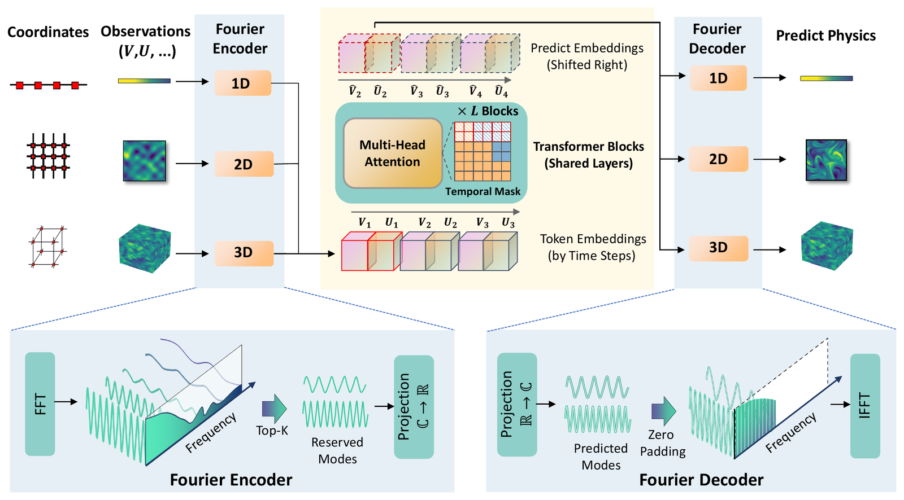

<p align="center"><a href="https://cnai4s.com"></a></p>

<h1 align="center">OmniArch-pt (智算天璇)</h1>

<p align="center">A foundation model for forecasting 1D, 2D and 3D partial differential equations with a single set of weights</p>

<p align="center">
  <a href="https://arxiv.org/abs/2402.16014"></a>
  <a href="LICENSE"></a>
  <a href="https://github.com/Tarpelite/omniarch_pt/stargazers"></a>
</p>

OmniArch-pt is a PyTorch implementation of OmniArch, a foundation model for scientific computing that forecasts the evolution of one-, two- and three-dimensional partial differential equations with a single set of weights. Given the leading frames of a simulation, the model predicts the subsequent frames autoregressively.

> **Preview release (v0.3).** The released checkpoints were trained from scratch on a subsampled version of PDEBench. They are intended for deployment and demonstration and do not reproduce the model or the results of the original paper. New results and checkpoints are published regularly.

## News

- **2026-10-22, v0.3.** Studies of joint training across spatial dimensions and of robustness to the frame spacing; faster training ([studies](docs/studies.md), [training](docs/training.md#training-speed)).
- **2026-10-22, v0.2.** Public release of the `base`, `mini` and `tiny` checkpoints together with a scaling study, a web demonstration and an HTTP interface.
- **2026-10-21, v0.1.** Initial PyTorch implementation with a command-line tool.

## Method



<sub>Architecture of OmniArch, reproduced from the ICML 2025 paper.</sub>

Each physical field at each time step is represented by one token. A Fourier encoder for each spatial dimension maps a field to a token, a shared Transformer with temporally causal attention predicts the tokens of the next time step, and a Fourier decoder maps them back to fields. Physical quantities are identified by their order rather than by name, so that a single model accepts arbitrary combinations of quantities and grid sizes.

## Quick start

```bash
git clone https://github.com/Tarpelite/omniarch_pt.git && cd omniarch_pt
python -m venv .venv && source .venv/bin/activate       # Windows: .venv\Scripts\activate
pip install torch --index-url https://download.pytorch.org/whl/cpu   # or the CUDA build for your GPU
pip install -e .
# place a checkpoint in ./weights/ (see Checkpoints)

omniarch info                      # model, device and supported quantities
omniarch predict 2d_turbulence --gif turb.gif
omniarch serve                     # web demonstration at http://127.0.0.1:7860
```

```python
from omniarch import OmniArchPredictor
p = OmniArchPredictor("weights/omniarch-base.pt")
future = p.predict(history, steps=10)      # history: (K, C, *grid); K >= 4 frames is recommended
```

The Python and HTTP interfaces and the input format are described in [docs/usage.md](docs/usage.md).

## Checkpoints

| Checkpoint | Parameters | Training | Mean nRMSE | Download (BUAA Pan, valid until 2027-10-22) |
|---|---|---|---|---|
| `omniarch-base.pt` (1.2 GB) | 308 M | 36k steps | 0.159 | https://bhpan.buaa.edu.cn/link/AA645380522EB54391B3A496443C6CD709 |
| `omniarch-mini.pt` (293 MB) | 77 M | 72k steps | 0.168 | https://bhpan.buaa.edu.cn/link/AA00790700453A44E893F3130C7DD2B618 |
| `omniarch-tiny.pt` (54 MB) | 14 M | 108k steps | 0.212 | https://bhpan.buaa.edu.cn/link/AA5516D6EE8EF74748AD809475482F5340 |

Mean nRMSE follows the PDEBench protocol (ten given frames, autoregressive rollout to the end of each trajectory, mean over nine PDE families; lower is better). Copying the last given frame yields 0.459. Without `--ckpt`, the tool loads `weights/omniarch-base.pt`, then `-mini`, then `-tiny`. Per-family results and zero-shot cases are listed in [docs/results.md](docs/results.md).

## Roadmap

- [x] PyTorch implementation, command-line tool, web demonstration and HTTP interface (v0.1)
- [x] `base`, `mini` and `tiny` checkpoints; scaling study (v0.2)
- [x] Studies of joint training across dimensions and of frame-spacing robustness; faster training (v0.3)
- [ ] Robustness to the frame spacing in the `base` checkpoint
- [ ] Larger checkpoints, towards approximately one billion parameters
- [ ] Training data beyond PDEBench
- [ ] Higher spatial resolution
- [ ] Domains other than periodic boxes
- [ ] Improved zero-shot performance on unseen problems

## Documentation

- [Usage](docs/usage.md): interfaces, input format and the number of given frames
- [Results](docs/results.md): per-family benchmark results and zero-shot cases
- [Studies](docs/studies.md): scaling, joint training across dimensions and frame spacing
- [Training](docs/training.md): data preparation, training and training speed
- [部署与使用指南](docs/deploy_guide.md): deployment guide (in Chinese)

## Citation

```bibtex
@inproceedings{chen2025omniarch,
  title     = {OmniArch: Building Foundation Model For Scientific Computing},
  author    = {Chen, Tianyu and Zhou, Haoyi and Li, Ying and Wang, Hao and Gao, Chonghan and Shi, Rongye and Zhang, Shanghang and Li, Jianxin},
  booktitle = {International Conference on Machine Learning},
  year      = {2025}
}
```

The training and evaluation data are taken from PDEBench (Takamoto et al., NeurIPS 2022 Datasets and Benchmarks Track), released under CC BY 4.0.

## Contact

Tianyu Chen (tianyuc@buaa.edu.cn). Questions and collaboration proposals are welcome by e-mail or through GitHub issues.

This project is part of [CNAI4S](https://cnai4s.com) (人工智能科学计算共性平台).

## Star history

[](https://www.star-history.com/#Tarpelite/omniarch_pt&Date)

## License

The code is released under the MIT License. The bundled example cases are derived from PDEBench (CC BY 4.0). The architecture figure is reproduced from the OmniArch paper.
