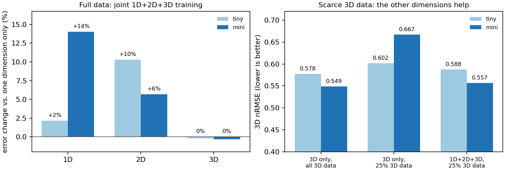

# Studies

This page summarises the controlled experiments underlying the released checkpoints. All models are evaluated with the protocol described in [results.md](results.md). The raw numbers are provided in the `results/` directory of the repository.

## Scaling

Thirty-six models were trained on PDEBench, each on a single GPU with 1D, 2D and 3D batches of 256, 64 and 16 samples per step. The raw numbers are in `results/scaling.json` and the analysis script is `scripts/analyze_scaling.py`.

| Model | Parameters | 12k steps (three seeds) | Longer training |
|---|---|---|---|
| nano | 4 M | 0.322 ± 0.002 | 0.257 after 108k steps |
| tiny | 14 M | 0.271 ± 0.003 | 0.212 after 108k steps |
| mini | 77 M | 0.217 ± 0.004 | 0.168 after 72k steps |
| base | 308 M | 0.187 ± 0.001 | 0.159 after 36k steps, 0.145 after 72k steps |
| large | 833 M | 0.180 (one seed) | — |

At a fixed budget of 12k steps, the mean error decreases with the number of parameters N approximately as N^-0.11 between 4 M and 308 M parameters, and the variation between seeds amounts to 1-2% of the differences between model sizes. The 833 M model lies above this trend, which indicates that it is under-trained at this budget.

At the present scale, training length matters more than model size: `base` trained for three times as many steps (0.159) outperforms `large` trained for 12k steps (0.180) at a lower computational cost.

The amount of data becomes relevant only for longer training. After 12k steps, a quarter of the training set yields the same error as the full set; after 36k to 108k steps, the models trained on a quarter of the data are 5-7% worse.

The three-dimensional error changes little with model size (N^-0.03) or training length. It is therefore limited by factors other than scale, most probably the small number of training trajectories (about 700) and the 32³ resolution.

## Joint training across spatial dimensions

This study examines whether a single model trained on one-, two- and three-dimensional data outperforms models trained on one dimension only. It comprises 22 runs of 36k steps each: `mini` with two seeds and `tiny` with one. The table reports the mean nRMSE per dimension; the one-dimensional reaction-diffusion family is excluded for the reason given in [results.md](results.md).

| Training data | mini 1D | mini 2D | mini 3D | tiny 1D | tiny 2D | tiny 3D |
|---|---|---|---|---|---|---|
| Single dimension | 0.126 | 0.140 | 0.549 | 0.206 | 0.179 | 0.578 |
| 1D + 2D + 3D | 0.143 | 0.148 | 0.547 | 0.210 | 0.197 | 0.576 |
| 3D only, 25% of the 3D data | | | 0.667 | | | 0.602 |
| 1D + 2D + 3D, 25% of the 3D data | | | **0.557** | | | 0.588 |

When training data are plentiful, joint training increases the one- and two-dimensional errors by 2-14% and leaves the three-dimensional error unchanged, which suggests that the dimensions compete for model capacity at these sizes.

When three-dimensional data are scarce, joint training is clearly beneficial. With a quarter of the three-dimensional trajectories, it reduces the three-dimensional error of `mini` by 17%, close to the error obtained with all three-dimensional data (0.549); both seeds agree (0.556 and 0.557).

The benefit grows with model size. The smaller model `tiny` overfits the reduced three-dimensional set only slightly (from 0.578 to 0.602) and gains 2%, whereas `mini` overfits more strongly (from 0.549 to 0.667) and gains 17%. The value of a single model for all dimensions thus lies mainly in problems with limited data, which is the typical situation for a new three-dimensional problem. The raw numbers are in `results/crossdim.json` and the analysis script is `scripts/analyze_crossdim.py`.

## Frame spacing

OmniArch does not receive the time step as an input; it infers the step from the change between consecutive given frames. The v0.2 checkpoints were trained with a single frame spacing per dataset, and on compressible flow their forecasts deteriorate when the frames are three to four times further apart than in training. Sampling the frame spacing uniformly between one and four during training removes this deficiency. The table reports the ratio of the model error to the error of copying the last frame, averaged over eight families, for four given frames and four forecast steps; lower values are better.

| Training | Spacing 1× | 2× | 3× | 4× |
|---|---|---|---|---|
| Fixed spacing (as in v0.2) | 0.50 | 0.60 | 0.71 | 0.87 |
| Random spacing between 1 and 4 | 0.52 | **0.33** | **0.30** | **0.33** |

With fixed spacing, the forecasts of one- and two-dimensional compressible flow at four times the training spacing are worse than copying the last frame; with random spacing, no family falls below this reference. Providing the spacing explicitly as an input yields the same numbers, so that inferring it from the context is sufficient. At an equal number of training steps, random spacing increases the error on the standard benchmark by 13% (`mini`, 0.204 against 0.180). This property will be incorporated into future `base` checkpoints. Training uses `--max_stride 4`, evaluation uses `scripts/eval_stride.py`, and the raw numbers are in `results/anystep.json`.
